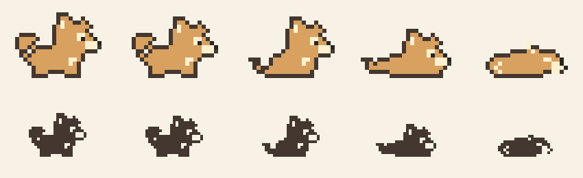

# 余粮 · Quota Pup

一只住在 macOS 菜单栏里的像素小狗，用姿态和动画表达 Codex 剩余额度。



菜单栏只显示小狗。点开后可以看到放大的小狗、剩余百分比和额度恢复时间。

## 五种状态

| 剩余额度 | 姿态 | 循环动画 |
| --- | --- | --- |
| 大于 70% | 精力满满 | 摇尾、探头、偶尔眨眼 |
| 大于 40%，不超过 70% | 状态不错 | 慢摇尾、眨眼 |
| 大于 15%，不超过 40% | 慢慢来 | 坐着摆尾、抖耳 |
| 大于 0%，不超过 15% | 快到休息时间了 | 趴着呼吸、轻摆尾 |
| 0% | 睡一觉再来 | 慢呼吸、偶尔动耳朵 |

五态共 46 帧，共用 24×18 像素网格。菜单栏使用系统单色模板图，面板显示暖色版本，自动适配深浅外观。系统开启“减少动态效果”时显示静态姿态。

## 环境要求

- macOS 14 或更新版本。
- Xcode 或可用的 Xcode Command Line Tools / Swift 工具链。
- Python 3，用于构建时生成独立的 HTML 设计预览。
- 已在本机 Codex 登录 ChatGPT 账号，存在有效的文件凭证。

**无需安装或运行 CodexBar，也不调用 Codex CLI 或其他辅助程序。** 额度读取代码已内置到余粮，使用系统 Foundation / URLSession 直接查询 OpenAI。

默认只读 `~/.codex/auth.json`。如设置 `CODEX_HOME`，则只读取该目录的 auth.json；当前版本不读取其他应用的凭证，也不读取 Keychain。
API Key 登录不能用于查询 ChatGPT 订阅额度。首次登录和共享令牌更新由 Codex 自己处理。

## 构建与运行

预编译应用可在 [GitHub Releases](https://github.com/hanhang-han/quota-pup/releases) 下载。选择与 Mac 芯片对应的文件，解压后将“余粮.app”拖到“应用程序”目录即可。
当前发布包为 Apple Silicon（arm64）版本。应用采用本地 ad-hoc 签名，尚未通过 Apple 公证；也可以按以下步骤自行编译。

```bash
git clone https://github.com/hanhang-han/quota-pup.git
cd quota-pup
./build.sh
open "build/余粮.app"
```

构建不需要下载 Swift 第三方依赖。编译目标明确为 macOS 14，与应用的最低系统版本声明一致。更早系统与其他设备尚未完成真机兼容性验证。

创建应用压缩包与 SHA-256 校验文件：

```bash
./release.sh
```

产物位于 build/release/。打包脚本会先构建并运行离线检查，不会读取真实账号凭证。

默认启动后展开小狗面板。只在菜单栏后台运行：

```bash
open "build/余粮.app" --args --background
```

点开右上角的“更多”，可刷新额度、查看最近读数或退出。没有自动安装开机启动项。

## 如何读取额度

每分钟用原生 HTTPS 请求一次官方服务：

```http
GET https://chatgpt.com/backend-api/wham/usage
Authorization: Bearer <本机 Codex 登录令牌>
ChatGPT-Account-Id: <本机 Codex 账号 ID（如有）>
```

令牌只从本机文件读入内存，并只发送到官方 HTTPS 域名；请求不携带浏览器 Cookie，不落盘缓存响应，也不会将凭证输出到日志。跨域或降级为 HTTP 的重定向会被拒绝。
此内部接口由 Codex 使用，其结构可能变化。

余粮每次同步都会重新读取文件，兼容 Codex 更新后的凭证。遇到 401 会再读取一次；只有凭证已经被 Codex 更新时才重试。余粮不会刷新共享 refresh token 或写入 auth.json，避免与 Codex 的令牌轮换冲突。登录失效会提示在 Codex 中重新登录。
读取失败时显示问号并标明上次读数；未知状态不会当成零额度。

若同时报告多个额度窗口，使用剩余百分比最少的窗口；恢复时间也来自该窗口。按窗口长度判断周期，不假设 primary 一定是短时额度。该工具展示 Codex 服务报告的额度，不代表 ChatGPT 所有模型的聊天次数。

动画按每帧到期时间调度并缓存菜单栏图标，长停顿期间不会固定频率轮询。当前同步结果写入本机 build/runtime-status.json，只含百分比、窗口、造型和时间，不含账号或令牌；此文件不纳入 Git。

## 源码与素材

```text
Sources/main.swift       AppKit 菜单栏、面板与动画
Sources/QuotaClient.swift 内置的凭证读取、HTTPS 请求与额度解析
Tests/QuotaClientTests.swift 额度读取的离线回归检查
test.sh                  运行离线检查，--live 可单次检查真实额度
Assets/sprites.json      五态的完整原始像素网格与动画帧时长
Assets/preview.gif       动画展示
Assets/poses.png         五种姿态概览
preview.template.html    交互设计稿的可编辑源码
preview.html             已生成、可离线打开的交互预览
build.sh                 校验素材、生成预览、编译并签名
docs/design-notes.md     造型与动画参数
REFERENCES.md            设计参考
```

修改 Assets/sprites.json 后重新运行 ./build.sh，原生资源和 HTML 预览会一起更新。
直接在浏览器打开 preview.html 可体验五档、深浅外观和断网状态；滑杆使用演示数据，与实际账号额度独立。

## 当前状态

这是可运行的早期原型，已在开发机完成 Swift 编译、真实额度同步与浏览器预览检查。尚未完成长期稳定性和多设备验收。
GitHub Actions 验证构建、素材和额度读取的离线回归检查，不访问真实账号或线上额度接口。
本地运行 ./test.sh 执行离线检查；需要手动核对真实接口时使用 ./test.sh --live，输出仅含汇总额度。

## 许可证与设计参考

源码与本仓库原创像素素材采用 [MIT](LICENSE) 许可证。
造型与动作参考 [pixelpets](https://github.com/JOhnsonKC201/pixelpets) 和 [oneko.js](https://github.com/adryd325/oneko.js)，像素网格为本次重新绘制。详见 [REFERENCES.md](REFERENCES.md)。
额度读取部分精简改编自 CodexBar 的 MIT 源码，相关版权声明见 [ThirdPartyNotices/CodexBar.txt](ThirdPartyNotices/CodexBar.txt)，并随应用一起打包。没有 CodexBar 运行时依赖。本项目不隶属于 OpenAI。
